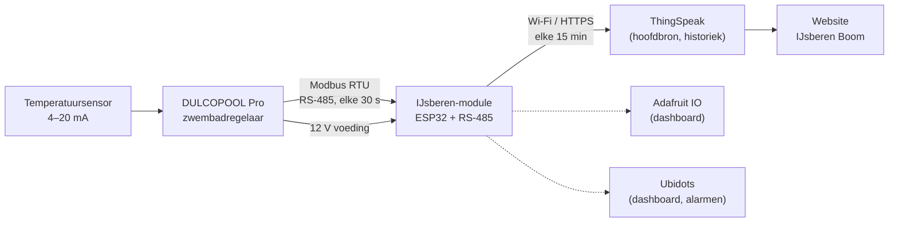
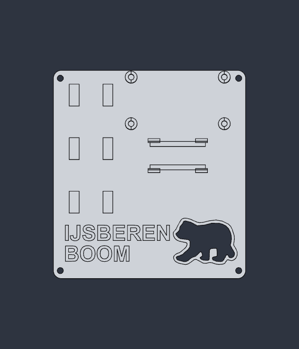
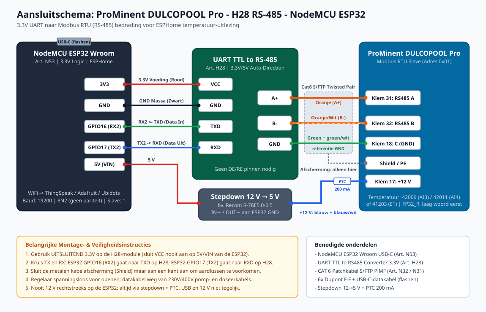

# IJsberen-module

Toont de **watertemperatuur van het zwembad live op de website van KZC IJsberen Boom**.
Een klein ESP32-bordje naast de zwembadregelaar (ProMinent DULCOPOOL Pro) leest de temperatuur
uit en stuurt ze elke 15 minuten naar de cloud. De website toont de laatste meting.

---

## 1. In één oogopslag



| | |
|---|---|
| **Wat** | Watertemperatuur van het zwembad op de clubwebsite, met historiek in de cloud |
| **Bron** | De temperatuur die de DULCOPOOL Pro zelf al meet en toont |
| **Module** | NodeMCU ESP32 + RS-485-module op een 3D-geprinte montageplaat, in een kastje naast de regelaar |
| **Firmware** | [ESPHome](https://esphome.io), één configuratiebestand |
| **Verbinding** | Modbus RTU naar de regelaar (één Cat 6-kabel, ook voor de voeding), Wi-Fi naar internet |
| **Cloud** | ThingSpeak (hoofdbron + website), Adafruit IO en Ubidots (extra dashboards); alle drie gratis |
| **Ritme** | Uitlezen elke 30 s, versturen elke 15 min, website ververst elke 90 s |

## 2. Hoe het werkt

1. **Meten.** De temperatuursensor in het zwembadwater hangt al aan de DULCOPOOL Pro. De regelaar
   rekent het 4–20 mA-signaal om naar °C en toont dat op zijn scherm. Daar verandert niets aan.
2. **Uitlezen.** De IJsberen-module vraagt de regelaar elke 30 seconden via **Modbus RTU** om die
   waarde, zoals een computer dat ook kan. Ze **leest alleen**: er wordt nooit iets naar de regelaar
   geschreven, dus de werking van het zwembad kan niet beïnvloed worden.
3. **Controleren.** Een meting telt alleen als ze binnen −5 … 45 °C ligt en minder dan 2 minuten
   oud is. Valt de verbinding met de regelaar weg, dan stuurt de module niets in plaats van een oude
   waarde.
4. **Versturen.** Elke 15 minuten gaat de laatste geldige temperatuur via Wi-Fi en HTTPS naar
   ThingSpeak, Adafruit IO en Ubidots.
5. **Bewaren.** De cloudplatformen bewaren de historiek en tonen grafieken. ThingSpeak bewaart
   onbeperkt; de andere twee ongeveer 30 dagen.
6. **Tonen.** De website haalt elke 90 seconden de laatste meting op uit ThingSpeak. Is die ouder
   dan 45 minuten (3 gemiste updates), dan toont de site "Offline" met het tijdstip van de laatste
   meting.

**Wat de module bewust niet doet:**

- Niets schrijven naar de regelaar of instellingen wijzigen.
- Metingen bufferen bij een internetstoring: dan ontstaat er een gat in de grafiek.
- Een eigen sensor gebruiken: ze gebruikt de meting van de regelaar, zodat website en regelaar
  altijd hetzelfde tonen.

**Waarom zo?**

| Keuze | Reden |
|---|---|
| Modbus RTU in plaats van de cloud van ProMinent (DULCOnneX) | Geen abonnement en geen afhankelijkheid van de fabrikant; de DULCOPOOL Pro stond in 2023 niet op de lijst van DULCOnneX-toestellen |
| ESPHome | Eén leesbaar configuratiebestand, updates via Wi-Fi, ingebouwde webpagina om te testen |
| Voeding uit de regelaar (12 V) | Geen stopcontact nodig; de module gaat aan en uit met de regelaar |
| Drie cloudplatformen | ThingSpeak volstaat; Adafruit IO en Ubidots geven extra dashboards en een back-up |

## 3. Status

| Onderdeel | Stand (19 november 2026) |
|---|---|
| Firmware | Geflasht op de ESP32; werkbanktest geslaagd (Wi-Fi, webpagina, Modbus wacht op de regelaar) |
| ThingSpeak | Kanaal **3588555** "ijsberen - dulcopool", publiek, velden *watertemperatuur* en *Wi-Fi signaal* |
| Website | Gekoppeld aan ThingSpeak-kanaal 3588555; toont "Nog geen metingen ontvangen" tot de eerste meting |
| Adafruit IO, Ubidots | Sleutels ingevuld; dashboards nog op te zetten |
| Installatie ter plaatse | **Nog te doen**: aansluiten, juiste temperatuuringang kiezen, eerste verzending testen (§9.6) |

## 4. Projectbestanden

| Bestand | Wat | In git |
|---|---|---|
| [esphome/dulcopool-temperatuur.example.yaml](esphome/dulcopool-temperatuur.example.yaml) | ESPHome-configuratie (sjabloon) → kopieer naar `dulcopool-temperatuur.yaml` | ✓ |
| [esphome/secrets.example.yaml](esphome/secrets.example.yaml) | Sjabloon voor Wi-Fi, wachtwoorden en API-sleutels → kopieer naar `secrets.yaml` | ✓ |
| `esphome/dulcopool-temperatuur.yaml`, `esphome/secrets.yaml` | Jouw ingevulde versies | ✗ (`.gitignore`) |
| [ES3C50P/](ES3C50P/README.md) | Variant met 5"-touchscreen (ESP32-S3, ES3C50P): grafiek en infoscherm met LVGL | ✓ (behalve eigen YAML en secrets) |
| [esp32-rs485-montageplaat.stl](esp32-rs485-montageplaat.stl) | Montageplaat om te 3D-printen (§6) | ✓ |
| [esp32-rs485-montageplaat.sc](esp32-rs485-montageplaat.sc) | Parametrisch ontwerp van de montageplaat (SolidCraft) | ✓ |
| [docs/aansluitschema_dulcopool_esp32.svg](docs/aansluitschema_dulcopool_esp32.svg) | Aansluitschema (§7) | ✓ |
| [website/](website/) | Clubwebsite met de temperatuurwidget (§10.4) | ✓ |
| [docs/BRIEFING.md](docs/BRIEFING.md) | Oorspronkelijke briefing (correcties in bijlage A) | ✓ |
| [docs/README-4G-arduino.md](docs/README-4G-arduino.md) | Eerdere versie van het plan (4G, Arduino, eigen backend) | ✓ |
| `docs/klemmen/` | Klemmenpagina's uit de handleiding van ProMinent | ✗ (auteursrecht, alleen lokaal) |

---

# Technische details

## 5. Hardware

Alle elektronica werkt op **3,3 V**, zodat de pinnen van de ESP32 veilig zijn.

| Onderdeel | Specificatie / artikel | Leverancier |
|---|---|---|
| Microcontroller | NodeMCU ESP32 WROOM, USB-C, CH340C, 3,3 V-logica (art. `N53`) | [Ben's Electronics](https://www.benselectronics.nl/products/nodemcu-esp32-wroom-wifi-en-bluetooth-usb-c) |
| RS-485-module | UART TTL to RS485 Converter, 3,3/5 V, automatische richting (art. `H28`) | [Ben's Electronics](https://www.benselectronics.nl/products/uart-ttl-to-rs485-converter) |
| Kabel naar de regelaar | Cat 6 S/FTP (PiMF), dubbel afgeschermd: 3 m (`N32`) of 10 m (`N31`) | [Ben's Electronics](https://www.benselectronics.nl/collections/netwerk-kabels) |
| Stepdown-converter | 12 V → 5 V, min. 500 mA, bv. **Recom R-78E5.0-0.5** (7–28 V in, geen koeling nodig) of een MP1584-moduletje afgesteld op 5,0 V | elektronicawinkel |
| Zekering | PTC ± 200 mA houdstroom (bv. Bourns MF-R020) **of** trage microzekering **T250mA** (TR5-type, radiaal) | elektronicawinkel / Amazon |
| Interne bedrading | 6× Dupont female-female (ESP32 ↔ H28 en ESP32 ↔ stepdown) | standaard |
| Montageplaat | 3D-geprint, zie §6 | zelf printen |
| Behuizing | IP65-doos met wartels, binnenmaat minstens ± 110 × 100 mm en ± 45 mm diep. In een technische ruimte van een zwembad is het vochtig en zit chloor in de lucht. | standaard |
| USB-C-**data**kabel | Alleen om de eerste keer te flashen; daarna gaan updates via Wi-Fi | standaard |
| Alternatieve voeding | 5 V USB-C-adapter (min. 1 A), als klem 17 van de regelaar al belast is (§7.3) | standaard |

> **Met scherm:** in plaats van de NodeMCU kan ook een ES3C50P (ESP32-S3 met 5"-touchscreen) de H28 aansturen.
> Pinnen, voeding en firmware staan in [ES3C50P/README.md](ES3C50P/README.md).

> **Gebruik niet** de goedkope 5 V-only MAX485-module (art. `Y26`). Die zet 5 V op de RX-pin van
> de ESP32 en kan het bord beschadigen.

## 6. Montageplaat (STL)



Een 3D-geprinte plaat waarop de ESP32 en de RS-485-module vast zitten, zodat ze in het kastje
niet los rondhangen.

| Kenmerk | Waarde |
|---|---|
| Afmetingen | 105 × 97 mm, 3 mm dik; totale hoogte 17 mm (met afstandhouders) |
| Bevestiging in het kastje | 4 gaten Ø 3,05 mm (M3) op 97 × 90 mm hartafstand, hoeken afgerond (r = 4 mm) |
| ESP32 | 4 afstandhouders Ø 6 × 14 mm met schroefgaatjes Ø 2,9 mm, op het gatenpatroon van de NodeMCU (47 × 23,5 mm, bord 51,5 × 28,5 mm) |
| RS-485-module (H28) | Klikt vast tussen twee rails met clips (module 43 × 14,3 mm), naast de ESP32 |
| Kabelbinder-ankers | 6 stuks, om de Cat 6-kabel te ontlasten en de stepdown en de zekering vast te binden |
| Afwerking | Gegraveerd "IJSBEREN BOOM" en het ijsberenlogo |

**Printen:** plat op het bed, met de afstandhouders naar boven. Kies **PETG of ASA** in plaats van
PLA: PLA vervormt bij warmte en vocht. Het ontwerp is parametrisch
([esp32-rs485-montageplaat.sc](esp32-rs485-montageplaat.sc)); maten zoals de afstand tussen de
gaten pas je daar aan en exporteer je opnieuw naar STL.

## 7. Aansluitschema en bedrading



> **Maak de regelaar spanningsloos voor je de behuizing opent.** De RS-485- en 12 V-klemmen zijn
> laagspanning, maar in dezelfde behuizing zit 230 V. Liefst doet een elektricien dit.

### 7.1 ESP32 ↔ H28 (Dupont-kabeltjes)

| H28 | NodeMCU ESP32 | Functie |
|---|---|---|
| VCC | **3V3** | 3,3 V voeding (nooit op 5V/VIN) |
| GND | GND | massa |
| TXD | **GPIO16** (RX2, op sommige printen **D16**) | data van RS-485 naar ESP32 |
| RXD | **GPIO17** (TX2, op sommige printen **D17**) | data van ESP32 naar RS-485 |

De H28 schakelt zelf tussen zenden en ontvangen, dus DE/RE-pinnen zijn niet nodig.

### 7.2 Module ↔ DULCOPOOL Pro (Cat 6-kabel)

| Module | Ader | DULCOPOOL Pro |
|---|---|---|
| H28 **A+** | oranje | **klem 31** – RS485 (A) |
| H28 **B−** | oranje/wit | **klem 32** – RS485 (B) |
| H28 **GND** (schroefklem aan de RS-485-kant, of de GND-pin) | groen + groen/wit samen | **klem 18** – C (GND): referentie én min van de voeding |
| stepdown **IN+** (via zekering) | blauw + blauw/wit samen | **klem 17** – +12 V (§7.3) |
| – | afscherming (gevlochten mantel) | PE/aarde, **alleen aan de kant van de regelaar** |
| – | bruin paar | vrij, reserve |

1. Knip de RJ45-stekkers af en strip de mantel.
2. Het groene paar is de **referentie-massa** voor RS-485 en tegelijk de min van de voeding.
   Zonder gemeenschappelijke massa kan RS-485 onbetrouwbaar zijn, zeker naast pompen. Omdat de
   module alleen via deze kabel met de regelaar verbonden is, ontstaat er geen aardlus.
3. De afscherming gaat alleen bij de regelaar aan PE.
4. Houd de kabel weg van 230 V/400 V-kabels.
5. **A/B-naamgeving verschilt per fabrikant.** Geen antwoord? Wissel eerst A en B om.
6. Microschakelaars op de printkaart van de regelaar (handleiding p. 68): **RS+ (A)** en
   **RS− (B)** = bias aan, **RS** = 120 Ω-afsluiting. Bij een kabel tot ± 10 m zijn ze meestal niet
   nodig; zet de bias aan als je timeouts blijft krijgen.

### 7.3 Voeding uit de regelaar (12 V)

De DULCOPOOL Pro heeft een DC-uitgang voor sensoren (handleiding p. 23 en 66): **klem 17 = +12 V,
klem 18 = C, max. 500 mA**. Een 5 V-uitgang is er niet, dus er komt een stepdown-converter tussen:

```
DULCOPOOL klem 17 (+12 V) ──blauw paar──[zekering]──► stepdown IN+    OUT+ (5 V) ──► NodeMCU 5V/VIN
DULCOPOOL klem 18 (C)     ──groen paar───────────────► H28 GND ── NodeMCU GND ── stepdown IN−/OUT−
```

De zekering en de stepdown zitten aan de kant van de module, in hetzelfde kastje.

**Eerst controleren (regelaar spanningsloos):**

1. **Hangt er al iets aan klem 17?** Volgens de handleiding is die uitgang bedoeld voor chloor- of
   broomsensoren die externe voeding nodig hebben. Tel hun verbruik op bij dat van de module. Komt
   het totaal boven ± 400 mA, of weet je het niet zeker, gebruik dan een 5 V USB-adapter.
2. Zet de regelaar aan en meet tussen klem 17 en 18: ongeveer 12 V.
3. Sluit de stepdown aan **zonder** ESP32 en meet de uitgang: 4,9–5,2 V.
4. Pas daarna de ESP32 aansluiten.

**Verbruik:** de ESP32 met Wi-Fi en de H28 trekken via de stepdown gemiddeld ± 100–150 mA uit de
12 V, met korte pieken tot ± 250 mA bij het zenden.

**Belangrijk:**

- **Nooit 12 V op de VIN-pin van de NodeMCU.** Daar zit een lineaire 3,3 V-regelaar die ± 9 V als
  warmte moet wegwerken; hij wordt te heet en valt uit.
- De **zekering** beschermt de regelaar: bij een kortsluiting aan de kant van de module blijven de
  regelaar en zijn sensoren gevoed. Een PTC herstelt vanzelf na afkoelen; een T250mA-zekering moet
  je na het doorslaan vervangen.
- **USB en 12 V niet tegelijk aansluiten.** Flash de eerste keer op de werkbank via USB. Na de
  installatie gaan updates via Wi-Fi (§9.5). Moet je toch via USB ter plaatse, haal dan eerst de
  5 V-draad van de stepdown los.
- Spanningsverlies op 10 m Cat 6 met twee aders per pool: ± 0,2 V.

### 7.4 Voeding en Modbus in dezelfde kabel

Dat mag; veel Modbus-toestellen krijgen zo hun 12/24 V. Voorwaarden:

- Elk signaal op een **eigen getwist paar** (oranje = A/B, blauw = +12 V, groen = C). Nooit voeding
  en data op hetzelfde paar.
- RS-485 is differentieel: een kleine, stabiele gelijkstroom op een ander paar stoort het niet.
- Alleen laagspanning: 230 V hoort nooit in deze kabel of in dezelfde kabelgoot.

### 7.5 Klemmenplan van de regelaar

Uit de [officiële handleiding van ProMinent](https://www.prominent.it/resources/OperatingInstructions/English/30667/990354-BA-DM-238-05-23-EN-DULCOPOOL-PRO-EN.pdf)
(document 990354, BA DM 238 05/23). De pagina's staan lokaal ook als afbeelding in `docs/klemmen/`
(niet in git).

| Pagina | Wat erop staat |
|---|---|
| 22 | Sensoringangen, klem 1–12: PI1/PI2 (pH/ORP), AI1/AI2 (chloor), **AI3 = 9/10**, **AI4 = 11/12** |
| 23–24 | Klem 13–40: **PWR 17 = +12 V, 18 = C (max. 500 mA)**, **RS485 31 = A, 32 = B**, analoge uitgangen, digitale ingangen, relais RO1/RO2 |
| 25 | Klem 41–52: relais FO1/FO2 (potentiaalvrij) en PO1/PO2 (**230 V**) |
| 26 | Netvoeding X1, klem 53–55 (L1/N/PE, 100–230 V AC) |
| 66 | Overzicht van de geopende behuizing, met de plaats van de PWR-klemmen |
| 67 | RS-485 naar een USB-converter: A → 31, B → 32, C → 18 |
| 68 | Microschakelaars RS, RS− (B) en RS+ (A) |

In de tabel op p. 22 staan AI3 en AI4 per vergissing ook als klem 7/8. De foto en de opdruk op de
print tonen 9/10 en 11/12.

## 8. De regelaar: Modbus

### 8.1 Instellingen op de regelaar

Menu → *Settings → Communication → Communication settings → MODBUS* (handleiding p. 70–71):

| Instelling | Waarde | In de YAML |
|---|---|---|
| Modbus on RS485 | **RTU** | – |
| Speed | **19200** | `baud_rate: 19200` |
| Parity | **None** ("WITHOUT", standaard) → 2 stopbits | `parity: NONE`, `stop_bits: 2` |
| Address | **1** | `address: 1` |

Sla op met het diskette-icoon. De instellingen moeten exact overeenkomen met de YAML. Staat de
pariteit op *Even*, zet dan in de YAML `parity: EVEN` en `stop_bits: 1`.

### 8.2 Registers

Alle registers zijn **holding registers** (functiecode 03); protocoladres = `register − 40001`.
REAL-waarden zijn IEEE-754 floats over 2 registers met het **laag woord eerst** (p. 85); in ESPHome
is dat `value_type: FP32_R`.

**Wat de module uitleest:**

| Op de webpagina | Register | Adres | Wat het is |
|---|---|---|---|
| AI3 sensorwaarde (42009) | 42009 | 2008 | Waarde van analoge ingang AI3 in de ingestelde eenheid (°C als de temperatuursensor daar hangt) |
| AI4 sensorwaarde (42011) | 42011 | 2010 | Idem voor AI4 |
| E1 meetwaarde (41203) | 41203 | 1202 | Meetwaarde van regelkanaal E1 (meestal pH of chloor) |
| AI3 stroom (41009) | 41009 | 1008 | Ruwe ingangsstroom AI3 in mA, ter controle |
| AI4 stroom (41011) | 41011 | 1010 | Ruwe ingangsstroom AI4 in mA, ter controle |
| PI1 / PI2 sensorwaarde (42001 / 42003) | 42001 / 42003 | 2000 / 2002 | Potentiometrische ingangen: pH en redox (§8.4) |
| AI1 / AI2 sensorwaarde (42005 / 42007) | 42005 / 42007 | 2004 / 2006 | Analoge ingangen, meestal chloor (§8.4) |
| PI1 / PI2 spanning (41001 / 41003) | 41001 / 41003 | 1000 / 1002 | Ruwe elektrodespanning in mV, ter controle |
| AI1 / AI2 stroom (41005 / 41007) | 41005 / 41007 | 1004 / 1006 | Ruwe ingangsstroom in mA, ter controle |
| pH, Redox, Vrij chloor | – | – | Kopie van de gekozen bron (§8.4); **alleen lokaal, niet naar de cloud** |

Omrekening bij de standaardschaal −5 … +45 °C: `T = −5 + (I_mA − 4) / 16 × 50`
(bv. 6,88 mA = 4,0 °C). Een lege ingang geeft ± 0 mA.

<details>
<summary>Volledige registertabel (handleiding Tab. 17, p. 79–85)</summary>

**Sensorwaarden in de ingestelde eenheid (REAL):**

| Register | Adres | Naam | Betekenis |
|---|---|---|---|
| 42001 / 42003 | 2000 / 2002 | sensor_PI1 / PI2 | pH/ORP |
| 42005 / 42007 | 2004 / 2006 | sensor_AI1 / AI2 | meestal chloor |
| **42009 / 42011** | **2008 / 2010** | **sensor_AI3 / AI4** | **vaak temperatuur** |
| 42013 / 42015 | 2012 / 2014 | sensor_MI1 / MI2 | module-ingangen |
| 42017 / 42019 | 2016 / 2018 | sensor_K1 / K2 | flow/volume |

**Ruwe ingangssignalen (REAL):** 41001/41003 = PI1/PI2 in mV, 41005/41007 = AI1/AI2 in mA,
41009/41011 = AI3/AI4 in mA.

**Regelkanalen E1…E8**, elk een blok van 50 registers (+50 per kanaal):

| Kanaal | state (DWORD, rw) | meetwaarde (REAL) | setpoint (REAL, rw) | dosering | alarm hoog | alarm laag |
|---|---|---|---|---|---|---|
| E1 | 41201 | **41203** | 41205 | 41207 | 41209 | 41211 |
| E2 | 41251 | 41253 | 41255 | 41257 | 41259 | 41261 |
| E3 | 41301 | 41303 | 41305 | 41307 | 41309 | 41311 |

De tabel in de handleiding bevat tikfouten, maar het patroon "+2 per veld, +50 per kanaal" is
consistent.

**Toestel:** 41092 = lokale tijd van de regelaar (DWORD, seconden sinds 1970, lokale tijd),
41101 = statuswoord (bit 0 = toestel draait), 41041…41046 = relais PO1, PO2, FO1, FO2, RO1, RO2.

**ParamState-bits** (DWORD op 41201, 41251, …): bit 0 parameter aan, bit 1 opstartvertraging,
bit 2 gepauzeerd, bit 3 = 0 → geen flow, bit 4 onderhoud nodig, bit 5 doseert, bit 6 alarm,
bit 7 pauze door timer, **bit 8 sensor buiten bereik of niet aangesloten**, bit 9 onder bereik.

</details>

### 8.3 Welke ingang is de temperatuur?

1. Op de regelaar: *Menu → Inputs*. De ingang met "Temperature" en eenheid °C (p. 89–90).
2. In de behuizing: zit de draad van de temperatuursensor op klem 9/10 (AI3) of 11/12 (AI4)?
3. Of op de webpagina van de module: vergelijk AI3, AI4 en E1 met het scherm van de regelaar
   (§9.6).

Zet de juiste bron in de YAML; alleen die gaat naar de cloud:

```yaml
temp_bron: temp_ai3   # of temp_ai4, of temp_e1
```

### 8.4 pH, redox en chloor

De module leest ook de waterkwaliteit uit. Die waarden staan **alleen op de webpagina van de module**
(met wachtwoord) en in de log. Ze gaan **niet** naar ThingSpeak, Adafruit IO of Ubidots, en dus ook
niet naar de website. Een tijdelijke piek zonder uitleg zou bezoekers alleen ongerust maken.

Welke ingang wat meet, hangt af van de bekabeling (sensoringangen op klem 1–12, §7.5). Standaard staat in de YAML:

```yaml
ph_bron: sensor_pi1      # pH-elektrode op PI1
redox_bron: sensor_pi2   # redox-elektrode (ORP) op PI2
chloor_bron: sensor_ai1  # chloorsensor (4–20 mA) op AI1
```

Controleer ter plaatse: vergelijk *PI1*, *PI2*, *AI1* en *AI2* op de webpagina met het scherm van de
regelaar, en pas de bron aan als het anders is. Filters gooien onmogelijke waarden weg: pH buiten
0–14, redox buiten ±2000 mV, chloor buiten 0–20 mg/l. Een niet-aangesloten ingang geeft dan
"onbekend".

## 9. Firmware (ESPHome)

### 9.1 Wat de configuratie doet

| Onderdeel | Instelling |
|---|---|
| Bord | `esp32dev`, framework ESP-IDF |
| Modbus | UART op GPIO17 (TX) / GPIO16 (RX), 19200 8N2, slave-adres 1, elke 30 s |
| Sensoren | AI3, AI4, E1 en de ruwe stromen van AI3/AI4; `Watertemperatuur` = kopie van `temp_bron`, gefilterd op −5 … 45 °C |
| Waterkwaliteit | PI1, PI2, AI1, AI2 en hun ruwe signalen; `pH`, `Redox` en `Vrij chloor` = kopie van `ph_bron`, `redox_bron`, `chloor_bron` (§8.4). Alleen lokaal. |
| Bewaking | "Meting actueel" staat aan zolang er de laatste 2 minuten een geldige temperatuur binnenkwam |
| Versturen | Elke 15 min en 2 min na het opstarten; alleen als "Meting actueel" aan staat |
| Cloud | **Alleen de watertemperatuur**: HTTPS-POST naar ThingSpeak (`field1` = temperatuur, `field2` = Wi-Fi-signaal), Adafruit IO en Ubidots; certificaten worden gecontroleerd |
| Webpagina | `http://dulcopool-temperatuur.local` (gebruiker `admin`): live waarden, log, knoppen "Nu naar de cloud sturen" en "Herstarten" |
| Wi-Fi | Bij geen verbinding na ± 1 min: hotspot `dulcopool-temperatuur fallback` om een nieuw netwerk in te stellen |
| Updates | Via Wi-Fi (OTA), met wachtwoord |

### 9.2 Voorbereiden op de Mac

1. ESPHome installeren:

   ```bash
   brew install esphome
   ```

2. Configuratie en geheimen aanmaken uit de sjablonen:

   ```bash
   cd esphome
   cp dulcopool-temperatuur.example.yaml dulcopool-temperatuur.yaml
   cp secrets.example.yaml secrets.yaml
   ```

3. Vul in:
   - `secrets.yaml`: Wi-Fi (alleen 2,4 GHz), drie zelfgekozen wachtwoorden en de API-sleutels (§10).
   - `dulcopool-temperatuur.yaml`: je Adafruit-gebruikersnaam bij `adafruit_username`.

4. Controleren:

   ```bash
   esphome config dulcopool-temperatuur.yaml
   ```

   Je moet eindigen met `INFO Configuration is valid!`.

### 9.3 Eerste keer flashen via USB

Sluit de NodeMCU aan met een USB-C-**data**kabel, zonder 12 V. Zoek de poort met `ls /dev/cu.*`
(bv. `/dev/cu.usbserial-10`). Zie je niets, probeer een andere kabel of installeer de
[CH34x-driver van WCH](https://www.wch-ic.com/downloads/CH34XSER_MAC_ZIP.html).

```bash
esphome run dulcopool-temperatuur.yaml --device /dev/cu.usbserial-10
```

- De eerste compilatie duurt 5–15 minuten (de ESP32-toolchain wordt gedownload); later ± 1 minuut.
- Blijft het hangen op `Connecting....`, houd dan de **BOOT**-knop ingedrukt tot het uploaden begint.
- Logs via USB later opnieuw bekijken: `esphome logs dulcopool-temperatuur.yaml --device /dev/cu.usbserial-10`

### 9.4 Werkbanktest (zonder regelaar)

| Wat je controleert | Verwacht resultaat |
|---|---|
| Wi-Fi | In de log `WiFi Connected!` met een IP-adres |
| Webpagina | `http://dulcopool-temperatuur.local`, inloggen met `admin` en je `web_password` |
| Modbus | Waarschuwingen `no response received`: normaal zonder regelaar |
| "Meting actueel" | **uit** |
| Knop "Nu naar de cloud sturen" | Log: `Geen actuele temperatuurmeting: niets verstuurd` |

### 9.5 Updates via Wi-Fi (OTA)

```bash
esphome run dulcopool-temperatuur.yaml --device dulcopool-temperatuur.local
```

Werkt `.local` niet, gebruik dan het IP-adres. Logs volg je via de webpagina. Let op: staat de
module op het zwembad, dan kan dat alleen vanaf een toestel op het netwerk van het zwembad.

### 9.6 Test ter plaatse

1. Regelaar: Modbus-instellingen controleren (§8.1), kijken wat er aan klem 17 hangt (§7.3).
2. Staat het Wi-Fi van het zwembad nog niet in `secrets.yaml`, vul het in en flash nog thuis via
   USB.
3. Regelaar spanningsloos, kabel aansluiten op klem 31/32/18/17 (§7.2), stepdown controleren
   (§7.3), regelaar aanzetten. De module start mee.
4. Open de webpagina. Binnen 30 s verschijnen waarden bij AI3, AI4 en E1. Kies de bron die de
   watertemperatuur toont (§8.3) en flash via Wi-Fi als het niet AI3 is.
   Doe hetzelfde voor pH, redox en chloor (§8.4).
5. **Watertemperatuur** heeft een waarde en **Meting actueel** staat aan.
6. Druk op **Nu naar de cloud sturen**. In de log:

   ```
   Versturen: 7.40 °C
   ThingSpeak: HTTP 200
   Adafruit IO: HTTP 200
   Ubidots: HTTP 200
   ```

   Controleer ThingSpeak-kanaal 3588555 en de website. ThingSpeak aanvaardt maar één update per
   15 s; twee keer snel na elkaar geeft `0`.
7. Laat het een uur draaien: er moeten 4–5 punten bijgekomen zijn.
8. Monteer alles in het kastje en plak een etiket met de naam van de fallback-hotspot (§9.7).

### 9.7 Als het Wi-Fi-wachtwoord verandert

1. Na ± 1 minuut zonder verbinding start de module de hotspot **`dulcopool-temperatuur fallback`**.
2. Verbind met je gsm (wachtwoord: `fallback_ap_password`). Er opent een venster; anders surf je
   naar `http://192.168.4.1`.
3. Kies het netwerk en geef het nieuwe wachtwoord in. De module verbindt opnieuw.
4. Pas daarna ook `secrets.yaml` aan, zodat een volgende flash het juiste wachtwoord bevat.

Bewaar het hotspotwachtwoord in de wachtwoordkluis van de club: zonder blijft alleen flashen via USB
over.

### 9.8 Probleemoplossing

| Symptoom | Oorzaak / oplossing |
|---|---|
| Geen `/dev/cu.usbserial…` | Laadkabel i.p.v. datakabel, of CH34x-driver ontbreekt |
| `Failed to connect to ESP32` | BOOT-knop ingedrukt houden tijdens `Connecting...` |
| Geen Wi-Fi | Alleen 2,4 GHz werkt; gebruik de fallback-hotspot (§9.7) |
| Modbus: geen antwoord | 1) A en B wisselen. 2) Groene massa-ader naar klem 18. 3) Instellingen 19200, pariteit, adres 1. 4) TXD/RXD (D16/D17) wisselen. 5) Bias-schakelaars RS+/RS− aanzetten. |
| Onzinwaarde (bv. `1.2e-41`) | Verkeerde woordvolgorde: probeer `FP32` i.p.v. `FP32_R` |
| Plausibele waarde, maar niet de temperatuur | Verkeerde `temp_bron` (§8.3) |
| Watertemperatuur leeg, sensorwaarde wel ingevuld | Waarde valt buiten −5 … 45 °C en wordt weggefilterd; controleer de schaal op de regelaar |
| Herstart steeds (`Brownout detector was triggered`) | 5 V zakt weg: meet de stepdown onder belasting, controleer zekering en klem 17 |
| Module dood, regelaar werkt | Zekering doorgeslagen of stepdown los; spanningsloos maken en nakijken |
| `HTTP -1` of `verzenden mislukt` | Geen internet, DNS of firewall (poort 443 naar buiten) |
| ThingSpeak antwoordt `0` | Verkeerde Write API Key of minder dan 15 s sinds de vorige update |
| Adafruit `401` / `404` | Verkeerde sleutel, gebruikersnaam of feed-key; `429` = te veel aanvragen |
| Ubidots `401` / `404` | Verkeerde token; probeer `ubidots_host: things.ubidots.com` |

## 10. Cloud en website

ThingSpeak is de hoofdbron (onbeperkte historiek, levert aan de website). Adafruit IO en Ubidots
zijn extra dashboards. Wil je er één weglaten, verwijder dan het blok in het `publiceer`-script van
de YAML. Bij één punt per 15 minuten gaat het om ± 35 000 berichten per jaar, ruim binnen alle
gratis limieten.

| Platform | Gratis plan | Historiek |
|---|---|---|
| [ThingSpeak](https://thingspeak.mathworks.com) | 3 miljoen berichten/jaar, 4 kanalen, min. 15 s tussen updates; alleen niet-commercieel | onbeperkt |
| [Adafruit IO](https://io.adafruit.com) | 10 feeds, 5 dashboards, 30 datapunten/min | 30 dagen |
| [Ubidots STEM](https://ubidots.com/stem) | ± 3 toestellen, niet-commercieel; limieten veranderen geregeld | ± 1 maand |

**Waar elke sleutel terechtkomt:**

| Waarde | Bestand | Veld |
|---|---|---|
| ThingSpeak Write API Key | `esphome/secrets.yaml` | `thingspeak_write_key` |
| ThingSpeak Channel ID (3588555) | `website/index.html` | `thingspeakChannelId` |
| Adafruit Username | `esphome/dulcopool-temperatuur.yaml` | `adafruit_username` |
| Adafruit Active Key | `esphome/secrets.yaml` | `adafruit_aio_key` |
| Ubidots Default Token | `esphome/secrets.yaml` | `ubidots_token` |

### 10.1 ThingSpeak

1. Account op [thingspeak.mathworks.com](https://thingspeak.mathworks.com).
2. **Channels → New Channel**: Field 1 `watertemperatuur`, Field 2 `Wi-Fi signaal`.
3. Tab **Sharing** → *Share channel view with everyone* (de website leest zonder sleutel).
4. Tab **API Keys** → **Write API Key** naar `secrets.yaml`.
5. Test:

   ```bash
   curl -s -X POST https://api.thingspeak.com/update.json -H "THINGSPEAKAPIKEY: JOUW_WRITE_KEY" -H "Content-Type: application/json" -d '{"field1": 7.4}'
   ```

   Een `entry_id` in het antwoord = goed. Testpunten wis je via **Channel Settings → Clear Channel**.

### 10.2 Adafruit IO

1. Account op [io.adafruit.com](https://io.adafruit.com).
2. **Feeds → New Feed** `zwembad-temperatuur` (de key moet ook `zwembad-temperatuur` zijn).
3. Geel sleutel-icoon: **Username** naar de YAML, **Active Key** naar `secrets.yaml`.
4. Test:

   ```bash
   curl -s -X POST "https://io.adafruit.com/api/v2/JOUW_USERNAME/feeds/zwembad-temperatuur/data" -H "X-AIO-Key: JOUW_AIO_KEY" -H "Content-Type: application/json" -d '{"value": 7.4}'
   ```

5. **Dashboards → New Dashboard** met een *Gauge* en een *Line Chart* op de feed.

### 10.3 Ubidots STEM

1. Account op [ubidots.com/stem](https://ubidots.com/stem).
2. Profiel → **API Credentials** → **Default Token** naar `secrets.yaml`.
3. Test (maakt meteen toestel `dulcopool-pro` met variabele `temperatuur` aan):

   ```bash
   curl -s -X POST "https://industrial.api.ubidots.com/api/v1.6/devices/dulcopool-pro" -H "X-Auth-Token: JOUW_TOKEN" -H "Content-Type: application/json" -d '{"temperatuur": 7.4}'
   ```

   `401`/`404`? Probeer host `things.ubidots.com` en zet die bij `ubidots_host` in de YAML.
4. **Data → Dashboards** met een *Thermometer* en *Line chart*; optioneel **Data → Events** voor
   e-mailalarmen (te warm/koud, geen data).

### 10.4 Website

De website ([website/index.html](website/index.html), [website/assets/js/main.js](website/assets/js/main.js))
leest `https://api.thingspeak.com/channels/3588555/feeds/last.json`, met `field1` als temperatuur
en `created_at` als meetmoment:

```js
window.IJSBEREN_CONFIG = {
  thingspeakChannelId: '3588555',
  apiUrl: '',            // alleen voor een eigen backend (temperature_c + received_at)
  refreshMs: 90 * 1000,  // elke 90 s opnieuw ophalen
  staleAfterMin: 45      // 3 gemiste updates = "offline"
};
```

| Situatie | Op de website |
|---|---|
| Geen Channel ID ingevuld | Voorbeeldwaarde 7,4 °C, gemarkeerd als voorbeeld |
| Meting jonger dan 45 min | Temperatuur, groene "live"-stip en het tijdstip |
| Laatste meting ouder dan 45 min | Laatste temperatuur met "Offline · laatste meting …" |
| Kanaal nog leeg | "Nog geen metingen ontvangen" |
| ThingSpeak onbereikbaar | "Watertemperatuur tijdelijk niet beschikbaar" |

Een grafiek van de voorbije week als iframe:

```html
<iframe width="450" height="260" style="border:1px solid #ccc"
  src="https://thingspeak.mathworks.com/channels/3588555/charts/1?days=7&type=line&title=Watertemperatuur&yaxis=%C2%B0C"></iframe>
```

### 10.5 Data exporteren

- **ThingSpeak:** **Data Import/Export → Export recent data**, of
  `https://api.thingspeak.com/channels/3588555/feeds.csv?days=365`.
- **Adafruit IO:** feed openen → **Download All Data** (max. 30 dagen).
- **Ubidots:** variabele openen → **Export to CSV**.

## 11. Stappenplan

1. ~~Firmware flashen en werkbanktest~~ (gedaan, §9.3–9.4).
2. ~~ThingSpeak-kanaal en website koppelen~~ (gedaan, kanaal 3588555).
3. Montageplaat printen (§6), stepdown en zekering bestellen (§5).
4. Op de regelaar: temperatuuringang en schaal opzoeken, Modbus instellen, kijken wat er aan
   klem 17 hangt (§7.3, §8).
5. Installeren en testen ter plaatse (§9.6).
6. Adafruit IO- en Ubidots-dashboards opzetten (§10.2–10.3).
7. Een week opvolgen: elke 15 minuten een punt? Wi-Fi-signaal (field 2) beter dan −75 dBm?

## 12. Open punten

- **Pariteit:** de handleiding toont als standaard 8N2, de briefing zei 8E1. Wat op de regelaar
  staat, bepaalt het.
- **Klem 17:** wat er al aan hangt, bepaalt of de module er gevoed kan worden (§7.3).
- **Registers:** de registertabel en woordvolgorde komen uit de handleiding; bevestig ze bij de
  eerste test ter plaatse.
- **H28 bij storing:** bij problemen met een lange kabel is een geïsoleerde module (bv. Waveshare
  TTL to RS485 (C)) de volgende stap.
- **Ubidots:** STEM-limieten en API-host verschillen per account.

---

## Bijlage A. Correcties op de briefing

De briefing ([docs/BRIEFING.md](docs/BRIEFING.md)) is de basis van deze opzet. Deze punten zijn
aangepast:

| Briefing | Aangepast naar | Waarom |
|---|---|---|
| Pariteit `EVEN`, 1 stopbit | **NONE**, **2 stopbits** (8N2) | Standaard volgens de handleiding (p. 70–71) |
| `byte_order: little_endian` | `value_type: FP32_R` | `byte_order` bestaat niet in ESPHome; `FP32_R` = laag woord eerst (p. 85) |
| Alleen register 41203 (E1) | 42009 (AI3) als standaard, met AI4 en E1 erbij | 41203 is een regelkanaal; de temperatuur staat op een analoge ingang |
| Menu *Instellingen → Interfaces → Modbus RTU* | *Settings → Communication → Communication settings → MODBUS* | Pad uit de handleiding (p. 70) |
| A/B zonder klemnummers, geen massa | Klem 31 = A, 32 = B, 18 = C (GND) | Handleiding p. 23–24 en 67 |
| `headers:` | `request_headers:` | Huidige naam in ESPHome |
| ThingSpeak-sleutel in de URL | Header `THINGSPEAKAPIKEY` | Sleutel blijft in `secrets.yaml` en verschijnt niet in logs |
| Laatste waarde wordt altijd verstuurd | Alleen bij een geldige meting van de laatste 2 minuten | Anders blijft een oude waarde na een storing "live" op de website |
| Eerste verzending pas na 15 min | 2 min na opstarten, plus een knop | Sneller testen |
| 5 V USB-voeding | 12 V uit de regelaar via stepdown en zekering | Geen stopcontact nodig |

## Bijlage B. Bronnen

- [ProMinent DULCOPOOL Pro – productpagina](https://www.prominent.com/en/Products/Products/Measuring-Control-and-Sensor-Technology/Controllers/p-dulcopool-pro.html)
- [DULCOPOOL Pro – officiële handleiding (PDF, Engels)](https://www.prominent.it/resources/OperatingInstructions/English/30667/990354-BA-DM-238-05-23-EN-DULCOPOOL-PRO-EN.pdf): klemmen p. 22–26, communicatie p. 66–78, registers p. 79–85
- [DULCOPOOL Pro – handleiding (ManualsLib)](https://www.manualslib.de/manual/1525941/Prominent-Dulcopool-Pro.html)
- [ESPHome – Modbus Controller (sensor)](https://esphome.io/components/sensor/modbus_controller/)
- [ESPHome – HTTP Request](https://esphome.io/components/http_request/)
- [ThingSpeak – Write Data](https://www.mathworks.com/help/thingspeak/writedata.html) en [licentie-FAQ](https://thingspeak.mathworks.com/pages/license_faq)
- [Adafruit IO – HTTP API](https://io.adafruit.com/api/docs/)
- [Ubidots – HTTP API](https://docs.ubidots.com/v1.6/reference/http)
