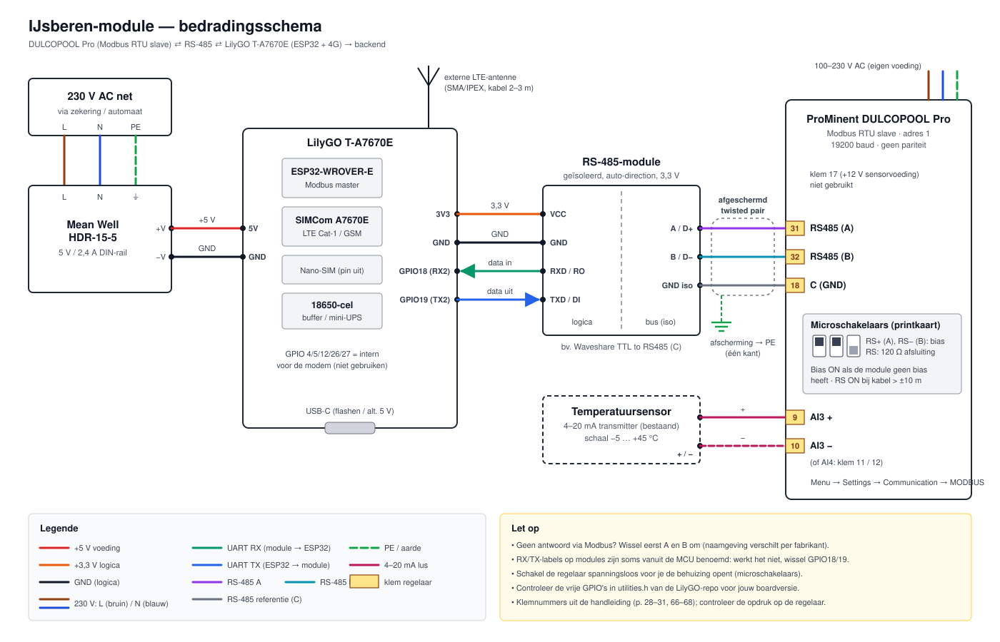

> **Gearchiveerd.** Dit is het eerdere plan (4G-board, Arduino-firmware, eigen backend).
> De actuele opzet met ESPHome staat in de [README](../README.md).

# IJsberen-module – watertemperatuur van de DULCOPOOL Pro naar de website

Plan om met een ESP32-board met 4G/SIM de watertemperatuur uit een
**ProMinent DULCOPOOL Pro** zwembadregelaar uit te lezen via **Modbus RTU (RS-485)** en die
elke 15 minuten als JSON naar een backend te posten, zodat de website altijd de
laatst gemeten temperatuur toont.

```
┌────────────────────┐  RS-485 (Modbus RTU)  ┌──────────────────────┐   LTE (SIM)   ┌──────────┐   HTTPS   ┌─────────┐
│  DULCOPOOL Pro     │  klem 31 A / 32 B / 18 │  ESP32 + A7670E 4G   │ ────────────► │ Backend  │ ◄──────── │ Website │
│  (Modbus slave)    │ ◄────────────────────► │  (Modbus master)     │  POST JSON    │  (API +  │  GET      │         │
│  temp-sensor op AIx│                        │  RS-485 transceiver  │  elke 15 min  │   DB)    │  latest   │         │
└────────────────────┘                        └──────────────────────┘               └──────────┘           └─────────┘
```

---

## 1. Wat de DULCOPOOL Pro kan (uit de documentatie)

Bron: *ProMinent DULCOPOOL Pro – Montage- und Betriebsanleitung*, Engelstalige sectie
([ManualsLib, 828 p.](https://www.manualslib.de/manual/1525941/Prominent-Dulcopool-Pro.html)).
Paginanummers hieronder zijn de **gedrukte** nummers; in de ManualsLib-viewer is dat *gedrukt + 140*
(bv. gedrukte p. 79 = `?page=219`).

| Onderwerp | Wat de handleiding zegt | Pagina |
|---|---|---|
| Interfaces | Modbus RTU (RS-485) en Modbus TCP (Wi-Fi/LAN) standaard aanwezig | productpagina |
| RS-485-klemmen | **RS485 (A) = klem 31**, **RS485 (B) = klem 32**, referentie/GND **(C) = klem 18** | 67 |
| Bias & afsluiting | Microschakelaars op de printkaart: *RS+ (A)* en *RS- (B)* = bias (polarisatie) aan; *RS* = 120 Ω afsluiting aan als de regelaar het laatste toestel op de bus is | 68 |
| Modbus-instellingen | Menu → *Settings → Communication → Communication settings → MODBUS*. Mode **RTU**, snelheid **19200**, pariteit **geen** ("SANS"), stopbits volgen automatisch de pariteit, slave-adres **1** (1…247) | 70–71 |
| Modbus TCP | Poort instelbaar (voorbeeld toont 520 op p. 71 en 502 op p. 78; 502 is de standaard) | 71, 78 |
| Registertype | Alles zijn **holding registers 40001…49999** → functiecode **0x03** (lezen) | 78 |
| Adressering | "Register 40001 = Modbus-adres 0" → protocoladres = `register − 40001` | 79 |
| REAL (float) | 2 registers, IEEE-754 32-bit, **laag woord eerst** (word-swapped, "CDAB"). Voorbeeld: 1,94 ppm = `0x3FF851EC` → reg n = `0x51EC`, reg n+1 = `0x3FF8` | 85 |
| Temperatuursensor | Temperatuur komt binnen als **4…20 mA** op een analoge ingang, normaal **AI3 of AI4** (niet-geïsoleerd, klemmen 9/10 en 11/12). Standaardschaal **−5…+45 °C**, klantspecifiek instelbaar tussen −10 en 100 °C | 28–31 |

> De DULCOPOOL Pro heeft **geen** Pt100/Pt1000-ingang: de temperatuur komt van een
> 4–20 mA-transmitter. De regelaar rekent de stroom zelf om naar °C, en die waarde lezen we uit.

### 1.1 Relevante Modbus-registers (Tab. 17, p. 79–84)

Alle registers: functiecode **03**, alleen lezen (`r`) tenzij anders vermeld.

**Sensorwaarden in de ingestelde eenheid** (voor ons de belangrijkste):

| Register | Protocoladres (dec / hex) | Naam | Type | Betekenis |
|---|---|---|---|---|
| 42001 | 2000 / 0x07D0 | sensor_PI1 | REAL | pH/ORP op PI1 |
| 42003 | 2002 / 0x07D2 | sensor_PI2 | REAL | pH/ORP op PI2 |
| 42005 | 2004 / 0x07D4 | sensor_AI1 | REAL | sensor op AI1 (bv. chloor) |
| 42007 | 2006 / 0x07D6 | sensor_AI2 | REAL | sensor op AI2 |
| **42009** | **2008 / 0x07D8** | **sensor_AI3** | **REAL** | **sensor op AI3 – vaak temperatuur [°C]** |
| **42011** | **2010 / 0x07DA** | **sensor_AI4** | **REAL** | **sensor op AI4 – of hier temperatuur [°C]** |
| 42013 / 42015 | 2012 / 2014 | sensor_MI1 / MI2 | REAL | module-ingangen |
| 42017 / 42019 | 2016 / 2018 | sensor_K1 / K2 | REAL | DI-sensoren (flow/volume) |

**Ruwe ingangsstroom** (fallback als de sensorwaarde niet bruikbaar is):

| Register | Adres | Naam | Type | Betekenis |
|---|---|---|---|---|
| 41001 / 41003 | 1000 / 1002 | signal_POT1/2 | REAL | spanning PI1/PI2 [mV] |
| 41005 / 41007 | 1004 / 1006 | Signal_AI1/2 | REAL | stroom AI1/AI2 [mA] |
| 41009 / 41011 | 1008 / 1010 | Signal_AI3/4 | REAL | stroom AI3/AI4 [mA] |

Omrekening bij standaardschaal −5…+45 °C: `T = −5 + (I_mA − 4) / 16 × 50`.

**Kanalen (regelparameters E1…E8)**: elk kanaal heeft een blok van 50 registers.
Is temperatuur als regelkanaal ingesteld, dan staat de meetwaarde ook hier:

| Kanaal | state (DWORD, rw) | gemeten waarde (REAL) | setpoint (REAL, rw) | dosering | alarm hoog | alarm laag |
|---|---|---|---|---|---|---|
| E1 | 41201 | **41203** | 41205 | 41207 | 41209 | 41211 |
| E2 | 41251 | **41253** | 41255 | 41257 | 41259 | 41261* |
| E3 | 41301 | **41303** | 41305 | 41307 | 41309 | 41311 |
| E4…E8 | +50 per kanaal | … | … | … | … | … |

\* De tabel in de handleiding bevat tikfouten (bv. "41251" twee keer), maar het patroon
"+2 per veld, +50 per kanaal" is consistent.

**Toestel / status**:

| Register | Adres | Type | Betekenis |
|---|---|---|---|
| 41092 | 1091 | DWORD (laag woord eerst) | lokale tijd regelaar, seconden sinds 1-1-1970 (lokale tijd, geen UTC) |
| 41101 | 1100 | WORD (rw) | bit 0 = toestel draait, bit 1 = timer actief, … |
| 41041…41046 | 1040… | BOOL | relais PO1, PO2, FO1, FO2, RO1, RO2 (0 = open, 1 = dicht) |

**ParamState-bits** (DWORD op 41201, 41251, …, p. 85): bit 0 parameter aan, bit 1 sensor in
opstartvertraging, bit 2 gepauzeerd, bit 3 = 0 → geen circulatie/flow, bit 4 sensor heeft
onderhoud nodig, bit 5 doseert, bit 6 alarm actief, bit 7 pauze door timer,
**bit 8 sensor buiten bereik of niet aangesloten**, bit 9 sensor onder bereik.

### 1.2 Hoe weet je op welke ingang de temperatuursensor zit?

1. Op de regelaar: **Menu → Inputs**. Daar zie je per ingang (PI1/PI2, AI1…AI4) welke sensor
   ingesteld is. Bij temperatuur staat er "Temperature" met eenheid °C (p. 89–90).
2. Of fysiek: de temperatuurtransmitter hangt op klem **9/10 (AI3)** of **11/12 (AI4)**.
3. Of met Modbus: lees `42001…42020` in één keer uit (20 registers = 10 floats) en kijk welke
   waarde rond de watertemperatuur ligt.

Zet het juiste register in `config.h` (`TEMP_REGISTER`). De firmware hieronder valt automatisch
terug op de ruwe stroom (`41009`/`41011`) als de sensorwaarde ontbreekt.

---

## 2. Hardwarekeuze

### 2.1 Aanbevolen: LilyGO T-A7670E (ESP32 + SIMCom A7670E)

| Waarom | |
|---|---|
| ESP32-WROVER-E (4 MB PSRAM) met **LTE Cat-1 + GSM-fallback** voor de EU-banden (B1/B3/B5/B7/B8/B20) | werkt met elke gewone simkaart of IoT-sim, ook waar geen LTE-M/NB-IoT is |
| Ingebouwde HTTPS/TLS-stack in de modem | geen TLS-certificaatgedoe op de ESP32 |
| 18650-batterijhouder + lader | de batterij vangt de stroompieken van de modem op en werkt als kleine UPS |
| Goede Arduino/PlatformIO-voorbeelden | [Xinyuan-LilyGO/LilyGO-T-A76XX](https://github.com/Xinyuan-LilyGO/LilyGO-T-A76XX) |

**Alternatieven**

- **LilyGO T-SIM7080G-S3** (ESP32-S3 + SIM7080G, LTE-M/NB-IoT): zuiniger, maar je hebt
  LTE-M/NB-IoT-dekking en een passende sim nodig. Op netstroom heeft dat weinig zin.
- **Zonder code: Teltonika TRB145/TRB245.** Industriële 4G-gateway met RS-485, een ingebouwde
  Modbus-master en "Data to Server" (HTTP POST van JSON). Duurder (± €150–250), maar DIN-rail,
  robuust en volledig te configureren via een webinterface.
- **Wi-Fi in plaats van 4G**: de DULCOPOOL Pro spreekt zelf Modbus TCP via Wi-Fi/LAN. Is er
  ter plaatse internet, dan kan een ESP32 zonder modem de waarde via Modbus TCP lezen. Dat valt
  buiten dit plan omdat je een sim wilt gebruiken.

### 2.2 Stuklijst

| # | Onderdeel | Voorbeeld | Indicatieve prijs |
|---|---|---|---|
| 1 | ESP32 + 4G-board | LilyGO T-A7670E (met LTE-antenne) | € 35–45 |
| 2 | RS-485-transceiver (3,3 V, **automatische richtingsturing**, liefst **galvanisch geïsoleerd**) | Waveshare "TTL to RS485 (C)" (geïsoleerd) of een MAX13487-/SP3485-module met auto-direction | € 5–15 |
| 3 | Voeding 230 V → 5 V, ≥ 2 A, DIN-rail | Mean Well HDR-15-5 (5 V / 2,4 A) | € 10–15 |
| 4 | 18650 Li-ion cel (buffer) | elke merkcel met beveiliging | € 5–8 |
| 5 | Externe LTE-antenne met kabel (technische ruimte = vaak slechte ontvangst) | SMA/IPEX-paddle of magneetvoet, 2–3 m kabel | € 10–20 |
| 6 | Kabel regelaar ↔ module | afgeschermd twisted pair, bv. LiYCY 2×2×0,5 mm² of Belden 3105A | € 1–2/m |
| 7 | Behuizing IP65 + wartels + DIN-rail | | € 15–25 |
| 8 | Simkaart | IoT-sim (bv. 1NCE, Things Mobile, EMnify) of een gewone prepaid-data-sim, **pincode uitgeschakeld** | – |
| 9 | Testen | USB-RS485-dongle (FTDI/CH340) | € 8–15 |

> Je kan de ESP32 ook voeden via de 12 V-sensoruitgang van de regelaar (klem 17/18, max. 500 mA,
> gedeeld met de sensoren) plus een buck-converter naar 5 V. Een 4G-modem trekt korte pieken tot
> ±2 A. Daarom raad ik een aparte voeding aan, met de 18650-cel als buffer.

### 2.3 Bedrading



```
DULCOPOOL Pro                         RS-485-module (geïsoleerde zijde)
──────────────                        ────────────────────────────────
klem 31  RS485 (A)  ───────────────── A / D+
klem 32  RS485 (B)  ───────────────── B / D−
klem 18  C (GND)    ───────────────── GND (iso)
                     (afscherming aan één kant aan aarde)

RS-485-module (logische zijde)        LilyGO T-A7670E
──────────────────────────────        ───────────────
VCC                 ───────────────── 3V3
GND                 ───────────────── GND
RXD (uit transceiver) ─────────────── GPIO 18  (UART2 RX)  ← controleer pinout
TXD (naar transceiver) ────────────── GPIO 19  (UART2 TX)  ← controleer pinout
```

- **A/B-naamgeving verschilt tussen fabrikanten.** Krijg je geen antwoord (timeouts), wissel
  dan A en B om. Dat is de nummer-1-oorzaak van problemen.
- Kabel korter dan ± 10 m bij 19200 baud: afsluiting is meestal niet nodig. Bij een langere kabel
  zet je de **RS**-schakelaar op de regelaar op ON en sluit je ook de module af met 120 Ω.
- Geen bias op de module? Zet dan de **RS+ (A)**- en **RS- (B)**-microschakelaars op de regelaar
  op ON (p. 68). **Schakel de regelaar spanningsloos** voor je de behuizing opent.
- Kies GPIO's die niet door de modem of de SD-kaart gebruikt worden. Bij de T-A7670E gebruikt de
  modem standaard GPIO 26/27 (UART), 4 (PWRKEY), 12 (POWER_ON) en 5 (RESET). Controleer dit in
  `utilities.h` van de LilyGO-repo.

### 2.4 Instellingen op de regelaar

Menu → *Settings → Communication → Communication settings → MODBUS*:

| Instelling | Waarde |
|---|---|
| Modbus on RS485 | **RTU** |
| Speed | **19200** (standaard) |
| Parity | **None** (standaard). Kijk welke stopbits het scherm toont, meestal **2** bij geen pariteit, volgens de Modbus-norm. Of kies **Even** → 8E1. |
| Address | **1** (of een ander vrij adres, 1…247) |

Druk op het diskette-icoon om op te slaan. De firmware moet exact dezelfde instellingen
gebruiken (p. 69: "must be identical").

---

## 3. Eerst testen met een laptop (sterk aangeraden)

Voor je firmware schrijft: hang een USB-RS485-dongle op klem 31/32/18 en lees met
[`mbpoll`](https://github.com/epsilonrt/mbpoll) (`brew install mbpoll`):

```bash
mbpoll -m rtu -a 1 -b 19200 -P none -s 2 -t 4:float -r 2001 -c 10 /dev/tty.usbserial-XXXX
```

- `-r 2001`: mbpoll telt vanaf 1, dus referentie 2001 = protocoladres 2000 = register **42001**
- `-t 4:float`: holding registers als float. mbpoll gebruikt standaard **laag woord eerst**,
  en dat is precies wat de DULCOPOOL Pro doet. (Gebruik **geen** `-B`.)
- Je krijgt 10 floats: PI1, PI2, AI1, AI2, **AI3**, **AI4**, MI1, MI2, K1, K2. De waarde rond de
  watertemperatuur is je temperatuurregister.

Ruwe stroom ter controle:

```bash
mbpoll -m rtu -a 1 -b 19200 -P none -s 2 -t 4:float -r 1001 -c 6 /dev/tty.usbserial-XXXX
```

Een GUI-alternatief is QModMaster of Modbus Poll. Kies dan float met de word order "Little-endian
byte swap" / "CDAB".

---

## 4. Firmware (ESP32, Arduino/PlatformIO)

### 4.1 Werking

1. Bij het opstarten: modem aanzetten, registreren op het netwerk, data-verbinding (APN) opzetten.
2. Elke **15 minuten** (instelbaar):
   - 3× de temperatuur lezen via Modbus (FC03, 2 registers, float CDAB), uitschieters weggooien,
     gemiddelde nemen;
   - extra info lezen: ruwe stroom, status (41101), klok van de regelaar (41092);
   - JSON opbouwen en via **HTTPS POST** naar de backend sturen met een API-sleutel;
   - mislukt de POST: de meting in een kleine wachtrij (RAM, max. 96 = 24 u) bewaren en de
     volgende keer meesturen.
3. Watchdog: hangt de modem of het programma, dan herstart het board vanzelf.
4. Optioneel: de backend antwoordt met `{"interval_s": 300}` om het interval op afstand te wijzigen.

### 4.2 Projectstructuur

```
firmware/
├── platformio.ini
├── include/config.h
└── src/main.cpp
```

`platformio.ini`

```ini
[env:t-a7670e]
platform = espressif32
board = esp32dev
framework = arduino
monitor_speed = 115200
board_build.partitions = huge_app.csv
build_flags =
    -DBOARD_HAS_PSRAM
lib_deps =
    4-20ma/ModbusMaster@^2.0.1
    bblanchon/ArduinoJson@^7.0.0
    ; TinyGSM-fork met A7670-ondersteuning + ingebouwde HTTPS, zoals gebruikt
    ; in de LilyGO-voorbeelden (kopieer lib/TinyGSM uit de LilyGO-T-A76XX repo)
```

`include/config.h`

```cpp
#pragma once

// --- Netwerk ---
#define SIM_PIN        ""                 // leeg = pin uitgeschakeld (aanbevolen)
#define APN            "iot.1nce.net"     // APN van je provider
#define APN_USER       ""
#define APN_PASS       ""

// --- Backend ---
#define BACKEND_URL    "https://api.example.com/v1/readings"
#define API_KEY        "vervang-mij"      // per toestel uniek
#define DEVICE_ID      "ijsberen-dulcopool-01"
#define POST_INTERVAL_S (15 * 60)

// --- Modem-pinnen LilyGO T-A7670E (verifieer in utilities.h van LilyGO) ---
#define MODEM_TX        26
#define MODEM_RX        27
#define MODEM_PWRKEY    4
#define MODEM_POWER_ON  12
#define MODEM_RESET     5

// --- RS-485 / Modbus ---
#define RS485_RX        18
#define RS485_TX        19
#define MODBUS_BAUD     19200
#define MODBUS_CONFIG   SERIAL_8N2        // geen pariteit → 2 stopbits; pas aan aan de regelaar
#define MODBUS_SLAVE_ID 1

// Temperatuur: sensorwaarde in °C (42009 = AI3, 42011 = AI4, of kanaal: 41203 = E1, ...)
#define TEMP_REGISTER        42009
// Fallback: ruwe stroom van dezelfde ingang (41009 = AI3, 41011 = AI4) + schaal
#define TEMP_RAW_MA_REGISTER 41009
#define TEMP_SCALE_MIN_C     (-5.0f)
#define TEMP_SCALE_MAX_C     (45.0f)
```

`src/main.cpp` (schets, nog niet getest op hardware; de HTTPS-calls volgen het voorbeeld
`HttpsBuiltlnPost` uit de LilyGO-repo)

```cpp
#define TINY_GSM_MODEM_A7670
#define TINY_GSM_RX_BUFFER 1024

#include <Arduino.h>
#include <TinyGsmClient.h>
#include <ModbusMaster.h>
#include <ArduinoJson.h>
#include <esp_task_wdt.h>
#include <vector>
#include <algorithm>
#include "config.h"

HardwareSerial SerialAT(1);
HardwareSerial RS485(2);
TinyGsm modem(SerialAT);
ModbusMaster mb;

static uint32_t seq = 0;
static uint32_t intervalS = POST_INTERVAL_S;
static std::vector<String> backlog;           // mislukte posts, max 96

// ---------- Modbus helpers ----------

// Register volgens de handleiding (4xxxx) → protocoladres
static inline uint16_t addr(uint32_t reg4x) { return reg4x - 40001; }

// REAL = IEEE-754, laag woord eerst (p. 85)
bool readFloat(uint32_t reg4x, float &out) {
  if (mb.readHoldingRegisters(addr(reg4x), 2) != mb.ku8MBSuccess) return false;
  uint32_t raw = ((uint32_t)mb.getResponseBuffer(1) << 16) | mb.getResponseBuffer(0);
  memcpy(&out, &raw, sizeof(out));
  return !isnan(out) && !isinf(out);
}

bool readDword(uint32_t reg4x, uint32_t &out) {
  if (mb.readHoldingRegisters(addr(reg4x), 2) != mb.ku8MBSuccess) return false;
  out = ((uint32_t)mb.getResponseBuffer(1) << 16) | mb.getResponseBuffer(0);
  return true;
}

bool readWord(uint32_t reg4x, uint16_t &out) {
  if (mb.readHoldingRegisters(addr(reg4x), 1) != mb.ku8MBSuccess) return false;
  out = mb.getResponseBuffer(0);
  return true;
}

// Mediaan van 3 metingen tegen uitschieters
bool readTemperature(float &tempC, const char *&source, float &rawMa) {
  std::vector<float> v;
  for (int i = 0; i < 3; i++) {
    float t;
    if (readFloat(TEMP_REGISTER, t) && t > -20 && t < 110) v.push_back(t);
    delay(200);
  }
  bool haveRaw = readFloat(TEMP_RAW_MA_REGISTER, rawMa);
  if (!v.empty()) {
    std::sort(v.begin(), v.end());
    tempC = v[v.size() / 2];
    source = "sensor";
    return true;
  }
  // Fallback: zelf omrekenen vanuit 4–20 mA
  if (haveRaw && rawMa >= 3.8f && rawMa <= 20.5f) {
    tempC = TEMP_SCALE_MIN_C + (rawMa - 4.0f) / 16.0f * (TEMP_SCALE_MAX_C - TEMP_SCALE_MIN_C);
    source = "raw_ma";
    return true;
  }
  return false;
}

// ---------- Modem ----------

void modemPowerOn() {
  pinMode(MODEM_POWER_ON, OUTPUT);
  digitalWrite(MODEM_POWER_ON, HIGH);
  pinMode(MODEM_RESET, OUTPUT);
  digitalWrite(MODEM_RESET, LOW);
  pinMode(MODEM_PWRKEY, OUTPUT);
  digitalWrite(MODEM_PWRKEY, LOW);
  delay(100);
  digitalWrite(MODEM_PWRKEY, HIGH);
  delay(100);
  digitalWrite(MODEM_PWRKEY, LOW);
}

bool ensureNetwork() {
  if (modem.isGprsConnected()) return true;
  if (!modem.testAT(5000)) { modemPowerOn(); delay(3000); }
  if (strlen(SIM_PIN) && modem.getSimStatus() != 3) modem.simUnlock(SIM_PIN);
  if (!modem.waitForNetwork(120000L)) return false;
  return modem.gprsConnect(APN, APN_USER, APN_PASS);
}

int httpsPost(const String &body, String &response) {
  modem.https_begin();
  if (!modem.https_set_url(BACKEND_URL)) { modem.https_end(); return -1; }
  modem.https_add_header("Content-Type", "application/json");
  modem.https_add_header("Authorization", String("Bearer ") + API_KEY);
  int code = modem.https_post(body);
  if (code > 0) response = modem.https_body();
  modem.https_end();
  return code;
}

// ---------- Meten & versturen ----------

String buildPayload() {
  JsonDocument doc;
  doc["device_id"] = DEVICE_ID;
  doc["seq"] = ++seq;
  doc["uptime_s"] = millis() / 1000;

  float tempC = NAN, rawMa = NAN;
  const char *source = "none";
  bool ok = readTemperature(tempC, source, rawMa);
  if (ok) doc["temperature_c"] = roundf(tempC * 10) / 10.0f;
  else    doc["temperature_c"] = nullptr;
  doc["temperature_source"] = source;
  doc["temperature_register"] = TEMP_REGISTER;
  if (!isnan(rawMa)) doc["raw_current_ma"] = roundf(rawMa * 100) / 100.0f;

  uint16_t status;
  if (readWord(41101, status)) {
    doc["controller"]["status_word"] = status;
    doc["controller"]["running"] = (bool)(status & 0x0001);
  }
  uint32_t ctrlTime;
  if (readDword(41092, ctrlTime)) doc["controller"]["local_time"] = ctrlTime;

  doc["modbus_ok"] = ok;
  doc["rssi"] = modem.getSignalQuality();      // 0–31 (99 = onbekend)
  doc["fw"] = "0.1.0";

  String out;
  serializeJson(doc, out);
  return out;
}

void sendCycle() {
  String payload = buildPayload();
  Serial.println(payload);

  if (!ensureNetwork()) {
    if (backlog.size() < 96) backlog.push_back(payload);
    return;
  }
  // Eerst de achterstand wegwerken
  while (!backlog.empty()) {
    String r;
    int c = httpsPost(backlog.front(), r);
    if (c < 200 || c >= 300) break;
    backlog.erase(backlog.begin());
  }
  String resp;
  int code = httpsPost(payload, resp);
  if (code >= 200 && code < 300) {
    JsonDocument r;
    if (!deserializeJson(r, resp) && r["interval_s"].is<uint32_t>()) {
      intervalS = constrain(r["interval_s"].as<uint32_t>(), 60u, 3600u);
    }
  } else if (backlog.size() < 96) {
    backlog.push_back(payload);
  }
}

void setup() {
  Serial.begin(115200);
  esp_task_wdt_init(300, true);                 // 5 min watchdog
  esp_task_wdt_add(NULL);

  RS485.begin(MODBUS_BAUD, MODBUS_CONFIG, RS485_RX, RS485_TX);
  mb.begin(MODBUS_SLAVE_ID, RS485);             // auto-direction transceiver: geen DE/RE nodig

  SerialAT.begin(115200, SERIAL_8N1, MODEM_RX, MODEM_TX);
  modemPowerOn();
  delay(3000);
  ensureNetwork();
}

void loop() {
  static uint32_t last = 0;
  esp_task_wdt_reset();
  if (last == 0 || millis() - last >= intervalS * 1000UL) {
    last = millis();
    sendCycle();
  }
  delay(1000);
}
```

> **Let op:** de exacte namen en signaturen van `https_*` verschillen per versie van de
> LilyGO-TinyGSM-fork. Neem ze over uit het voorbeeld in de repo die je gebruikt. Heb je een
> transceiver **met** DE/RE-pin, gebruik dan `mb.preTransmission()`/`mb.postTransmission()` om
> die pin te schakelen.

**Alternatief zonder C++**: ESPHome heeft een `modbus_controller`-component (float met
`register_type: holding`, `value_type: FP32_R` = word-swapped). 4G-ondersteuning in ESPHome is
wel minder volwassen dan TinyGSM. Voor dit project zou ik daarom bij Arduino/PlatformIO blijven.

---

## 5. JSON-payload

`POST https://api.example.com/v1/readings`
Headers: `Content-Type: application/json`, `Authorization: Bearer <API_KEY>`

```json
{
  "device_id": "ijsberen-dulcopool-01",
  "seq": 1287,
  "uptime_s": 1159200,
  "temperature_c": 4.7,
  "temperature_source": "sensor",
  "temperature_register": 42009,
  "raw_current_ma": 7.10,
  "controller": {
    "status_word": 5,
    "running": true,
    "local_time": 1793359800
  },
  "modbus_ok": true,
  "rssi": 18,
  "fw": "0.1.0"
}
```

- **Tijdstempel**: de backend zet zelf `received_at` (UTC) bij ontvangst. Dat is betrouwbaarder
  dan een klok op de ESP32. `controller.local_time` is de klok van de regelaar in lokale tijd.
  Die is handig om achterstand-posts (`seq`) in de juiste volgorde te zetten.
- `temperature_c = null` + `modbus_ok = false` → de website toont "sensor/communicatie offline".
- Antwoord van de backend: `200 {"ok": true, "interval_s": 900}` (het interval is optioneel).

**Dataverbruik**: ±1 KB payload + TLS-handshake ≈ 5–8 KB per post → 96 posts/dag ≈ 0,5–0,8
MB/dag ≈ **15–25 MB/maand**. Een IoT-sim met 50–100 MB/maand is ruim voldoende. Wil je minder
data of vaker posten, dan is MQTT over TLS met een persistente verbinding zuiniger.

---

## 6. Backend & website

Minimaal nodig:

| Endpoint | Doel |
|---|---|
| `POST /v1/readings` | API-sleutel controleren, payload valideren, `received_at` toevoegen, opslaan |
| `GET /v1/readings/latest?device_id=…` | laatste meting voor de website (publiek, gecachet) |
| `GET /v1/readings?device_id=…&from=…&to=…` | historiek voor een grafiek (optioneel) |

Opslag: één tabel `readings(device_id, received_at, temperature_c, payload jsonb)`. Dat past
in Postgres/Supabase, SQLite, Netlify Blobs of een serverless KV.

Voorbeeld (Node/Express):

```js
app.post('/v1/readings', express.json(), async (req, res) => {
  if (req.get('authorization') !== `Bearer ${process.env.API_KEY}`) return res.sendStatus(401);
  const r = req.body;
  if (typeof r.device_id !== 'string') return res.sendStatus(400);
  await db.insert('readings', {
    device_id: r.device_id,
    received_at: new Date(),
    temperature_c: typeof r.temperature_c === 'number' ? r.temperature_c : null,
    payload: r,
  });
  res.json({ ok: true, interval_s: 900 });
});

app.get('/v1/readings/latest', async (req, res) => {
  const row = await db.latest('readings', req.query.device_id);
  res.set('Cache-Control', 'public, max-age=60').json(row);
});
```

**"Real-time" op de website**: de sensor levert elke 15 minuten een nieuwe waarde. Het volstaat
dus dat de website `GET /latest` om de 1–2 minuten opvraagt (of Server-Sent Events/WebSocket
gebruikt als je backend dat ondersteunt). Toon altijd het tijdstip erbij, bv.
"**4,7 °C** – gemeten om 14:15". Is de laatste meting ouder dan ±45 min, toon dan "offline".
Wil je het echt live, verlaag dan het interval via `interval_s` (bv. 60 s). Het dataverbruik
stijgt dan evenredig mee.

---

## 7. Stappenplan

1. **Regelaar controleren**: *Menu → Inputs* → op welke ingang staat de temperatuur (AI3/AI4)?
   Noteer de schaal (standaard −5…+45 °C). Zet Modbus RTU, 19200, pariteit, adres 1 en sla op.
2. **Laptoptest**: USB-RS485 op klem 31/32/18, `mbpoll` zoals in §3. Bevestig het
   temperatuurregister en de woordvolgorde.
3. **Hardware bestellen** (§2.2) en de sim activeren (pincode uit, APN noteren).
4. **Backend** opzetten (§6) met een test-API-sleutel. Test met `curl`.
5. **Firmware** flashen met `config.h` ingevuld. Eerst op de werkbank met USB-voeding en de
   seriële monitor: zie je de JSON en 200-antwoorden?
6. **Installatie** in een IP65-doos naast de regelaar, met de externe antenne naar een plek met
   ontvangst en afgeschermde kabel naar klem 31/32/18.
7. **Website** koppelen aan `GET /latest` en een "offline"-melding tonen bij oude data.
8. **Een week monitoren**: RSSI, achterstand-posts, watchdog-resets. Daarna het interval
   eventueel bijstellen.

## 8. Open punten / te verifiëren

- Registertabel en woordvolgorde komen uit de ManualsLib-versie van de handleiding. De
  ProMinent-downloadpagina was tijdens het opzoeken onbereikbaar. Vraag bij ProMinent de
  officiële PDF (en firmwareversie) op en **controleer met `mbpoll`** voor je de firmware vastlegt.
- Modbus RTU via RS-485 en Modbus TCP via Wi-Fi staan in hetzelfde instelscherm. Of ze tegelijk
  actief kunnen zijn, is niet duidelijk. Voor dit plan is alleen RTU nodig.
- De handleiding is inconsistent over de bits van register 41101 (p. 80 vs. p. 85). Gebruik
  alleen bit 0 (toestel draait) en stuur het ruwe statuswoord mee.
- Pinout en `https_*`-API van de LilyGO-board/TinyGSM-fork controleren tegen de versie die je
  koopt.
